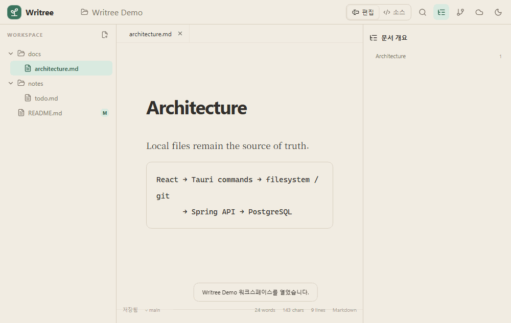
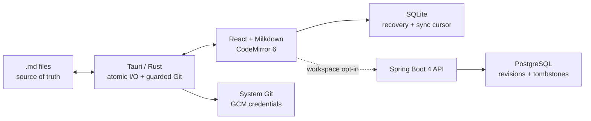

# Writree

> **Write naturally. Keep every version.**  
> 로컬 Markdown 파일을 그대로 두고, 필요한 순간에만 Git으로 기록하는 Windows 데스크톱 에디터입니다.



Writree는 Typora의 방해 없는 WYSIWYG 경험에 개발자의 Git 워크플로를 결합합니다. 로그인이나 서버 없이 폴더를 열어 편집하고, diff를 확인한 뒤 선택한 문서만 명시적으로 커밋·푸시할 수 있습니다. 계정 동기화는 원하는 워크스페이스에서만 켭니다.

_Writree is a local-first Markdown and Git desktop editor for Windows. Markdown files remain portable, Git operations stay explicit, and optional sync never resolves concurrent edits with silent last-write-wins._

## 왜 Writree인가

Markdown 에디터가 문서를 자체 데이터베이스 안에 가두면 앱을 떠나는 순간 파일의 주도권도 잃습니다. 반대로 일반 텍스트 편집기만으로는 문서 구조, 이미지, 표를 계속 문법으로 해석해야 합니다. Writree는 그 사이를 목표로 합니다.

- **로컬 파일이 원본**: `.md` 파일만 문서 원본입니다. SQLite에는 복구본, 최근 폴더, 동기화 기준만 둡니다.
- **Git은 의도적으로**: 상태와 diff는 보여주되 stage·commit·push는 사용자 동작으로만 실행합니다. 관련 없는 변경은 건드리지 않습니다.
- **충돌은 보존으로 해결**: 기준 revision이 다르면 덮어쓰지 않고 원격본을 `*.conflict-날짜-장치.md`로 남깁니다.
- **서버 없이 완전한 편집기**: 로그인과 Spring 서버는 선택 사항입니다. 로컬 편집과 Git에는 영향을 주지 않습니다.

## 현재 구현된 기능

- Milkdown 기반 CommonMark/GFM WYSIWYG와 CodeMirror 6 소스 모드
- 폴더 트리, 다중 탭, 개요, 찾기·바꾸기, 단어/문자/줄 수, 라이트·다크 테마
- 1.5초 자동 저장, UTF-8 및 기존 LF/CRLF 보존, SHA-256 기반 외부 변경 감지, 복구 snapshot
- 이미지 paste/drop 시 `assets/`에 충돌 없는 이름으로 저장하고 상대 경로 삽입
- Git status·diff, 선택 파일 commit, 기존 upstream push, 위험한 repository 상태 안내
- GitHub OAuth 일회용 코드, 짧은 JWT, 회전 refresh token, Windows Credential Manager 보관
- 워크스페이스별 opt-in batch sync, cursor pull, revision 100개, tombstone 30일, conflict copy
- Tauri 2 NSIS 설정과 GitHub Actions 기반 unsigned Windows 릴리스

## 아키텍처



모노레포 구성은 다음과 같습니다.

```text
apps/desktop        React + TypeScript + Vite + Tauri 2
apps/server         Java 21 + Spring Boot + Flyway
packages/api-client OpenAPI 계약을 따르는 TypeScript client/types
docs                ADR, 아키텍처, 지원 문법, 원래 기획서
```

더 자세한 결정 배경은 [아키텍처](docs/architecture.md)와 [ADR](docs/adr)에서 확인할 수 있습니다. 기존 `plan.md`의 내용은 [초기 설계 문서](docs/legacy-plan.md)로 보존했습니다.

## 로컬 실행

필요한 도구는 Node.js 22+, pnpm 11+, Rust stable, MSVC Build Tools, Java 21+, Git입니다. Windows 11 x64를 우선 지원합니다.

```powershell
git clone <your-repository-url>
cd writree
pnpm install
pnpm dev                 # 브라우저 demo adapter
pnpm tauri dev           # 실제 파일 시스템을 사용하는 데스크톱 앱
```

서버 없이 실행하면 우측 동기화 패널만 비활성화되고 나머지 기능은 그대로 동작합니다.

## 선택형 동기화 데모

`.env.example`을 `.env`로 복사하고 GitHub OAuth App의 callback URL을 `http://localhost:8080/login/oauth2/code/github`로 설정합니다. `GITHUB_CLIENT_ID`, `GITHUB_CLIENT_SECRET`, 충분히 긴 `WRITREE_JWT_SECRET`을 입력한 뒤 실행합니다.

```powershell
docker compose up --build
$env:VITE_WRITREE_API_URL="http://localhost:8080"
pnpm tauri dev
```

OAuth 완료 후 서버는 2분 동안 한 번만 사용할 수 있는 코드를 `writree://auth/callback`으로 전달합니다. 서버는 refresh token 원문이나 GitHub repository token, 로컬 절대 경로를 저장하지 않습니다.

## 테스트와 품질 기준

```powershell
pnpm typecheck
pnpm test
pnpm build
pnpm --filter @writree/desktop test:e2e
cargo test --manifest-path apps/desktop/src-tauri/Cargo.toml
apps/server/mvnw.cmd test
```

현재 자동 검증은 Markdown/frontmatter·한글·LF/CRLF fixture, 외부 수정 방지, conflict copy, 선택 Git commit, 경로 탈출 거부, API hash/path 계약, PostgreSQL 동시 수정 conflict를 포함합니다. PostgreSQL 통합 테스트는 Docker가 없으면 skip됩니다.

개발 머신 기준 Rust I/O 테스트에서 약 1.05MB Markdown 파일을 **50ms 미만**에 읽었습니다(목표 3초). 실제 편집 p95 50ms 목표는 릴리스 빌드 telemetry가 아닌 Playwright 입력 benchmark로 계속 추적할 예정입니다.

## 보안·개인정보 원칙

- webview에는 임의 shell 실행 API가 없습니다. Git 인자는 Rust에서 제한하고 모든 pathspec 앞에 `--`를 사용합니다.
- 절대 로컬 경로는 서버로 보내지 않으며 선택하지 않은 워크스페이스는 동기화하지 않습니다.
- 저장 전 예상 해시가 다르면 기존 파일을 덮지 않습니다. 적용된 원격 삭제도 `.writree-trash`에 먼저 보존합니다.
- Git push는 사용자가 이미 설정한 Git Credential Manager 등 로컬 인증만 사용합니다.
- 운영 서버는 TLS, 암호화된 디스크, 접근 통제를 전제로 합니다. 종단간 암호화는 아직 지원하지 않습니다.

## 로드맵

| 버전 | 범위 | 상태 |
|---|---|---|
| v0.1 | 로컬 편집, 안전한 저장, GFM, 한글 IME | 구현 |
| v0.2 | Git status/diff/commit/push, 이미지 assets | 구현 |
| v0.3 | OAuth, Spring/PostgreSQL sync, revision/conflict | 구현 |
| v1.0 | UX 다듬기, Windows installer, CI, 성능 공개 | 검증 중 |

알려진 제한: Windows 11 x64 우선, 수식·Mermaid·PDF 내보내기·모바일·실시간 공동 편집·플러그인·AI 작성은 v1 범위가 아닙니다. 첫 공개 설치판은 코드 서명이 없어 SmartScreen 경고가 표시될 수 있습니다. 공개 릴리스 전에 `Writree` 상표·도메인·스토어 이름 사용 가능성을 다시 확인합니다.

## 라이선스

[MIT](LICENSE). 이 프로젝트는 Typora의 코드를 사용하지 않는 독립 구현입니다.
