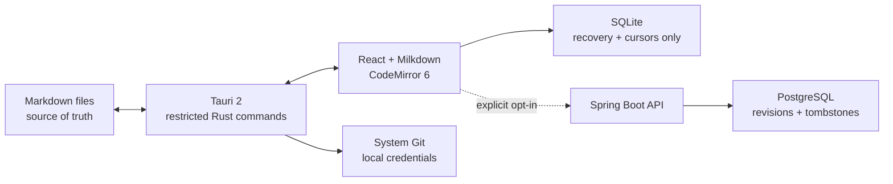

# Architecture

The browser-facing code depends on `FilePort`, `GitPort`, `AuthPort`, and
`SyncPort` boundaries. Browser development uses a memory/localStorage adapter;
the installed app uses narrowly scoped Tauri commands. No arbitrary shell
command is exposed to the webview.

The OpenAPI contract in [`openapi.yaml`](openapi.yaml) is the source for the
shared API types. Local absolute paths never cross the sync boundary.
